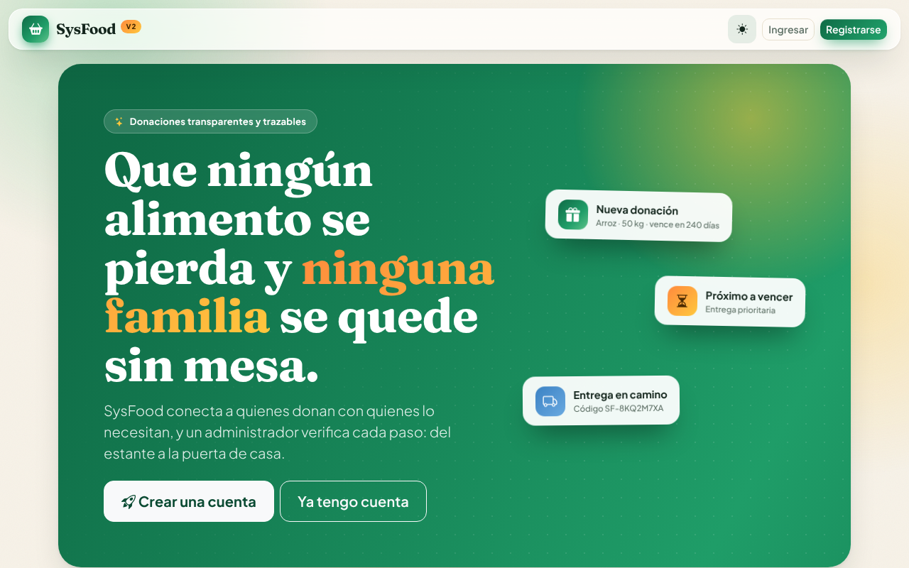
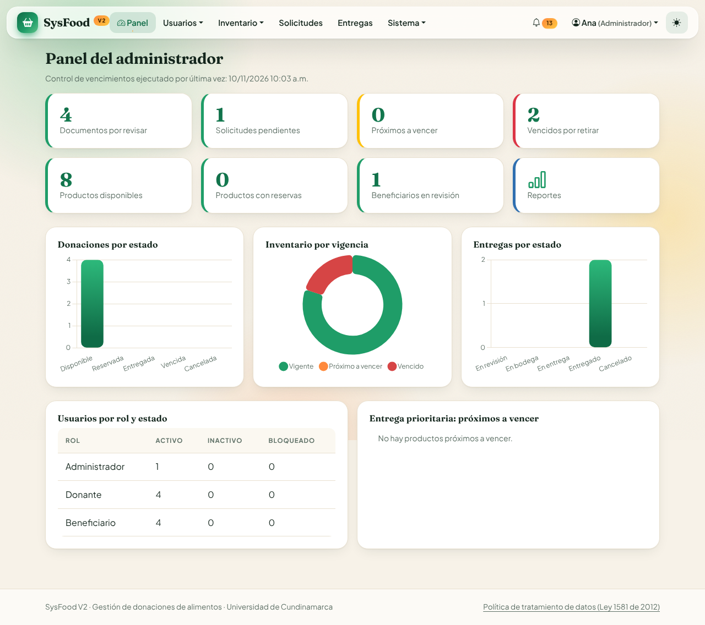
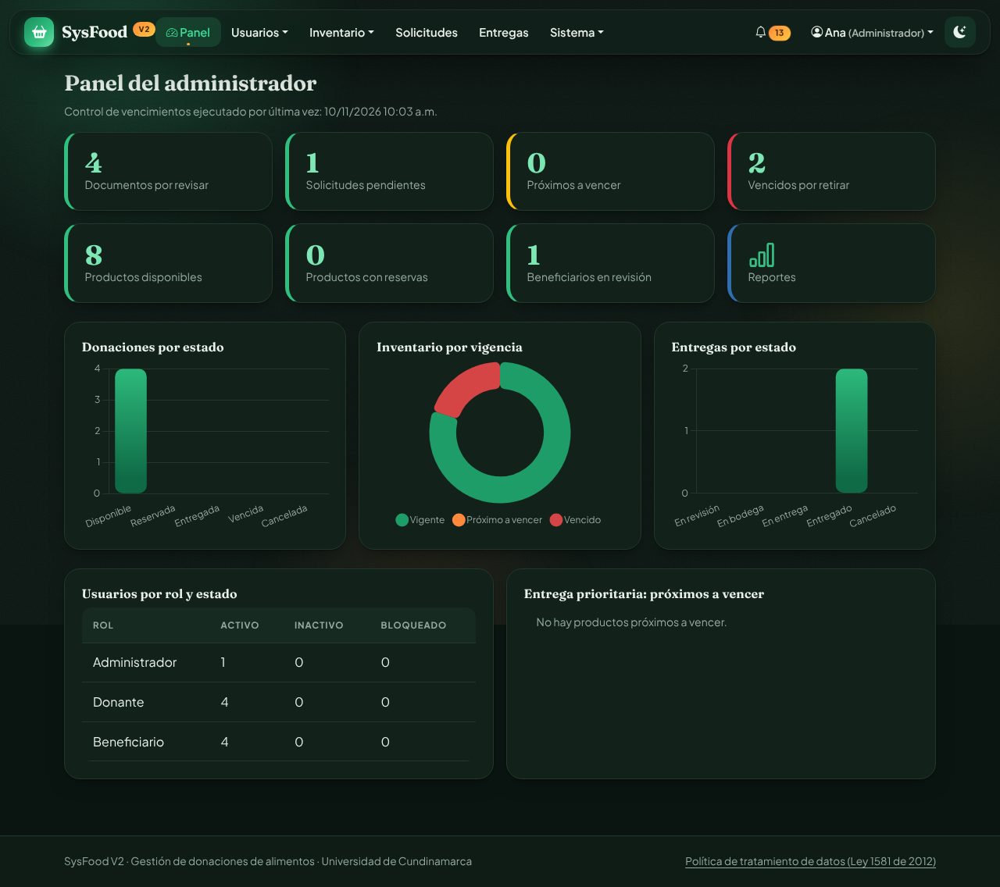

# SysFood V2

Sistema de información web para la gestión de donaciones de alimentos.
Conecta a **donantes** (personas naturales o jurídicas, públicos o anónimos) con **beneficiarios** en condición de vulnerabilidad, bajo la supervisión de un **administrador**.

- **Tecnología:** Python 3.10+ · Django 5.2 · MySQL 8 · Bootstrap 5 · Chart.js
- **Funciona en:** Windows, Linux y macOS · Chrome, Edge y Firefox · computador, tableta y celular
- **Interfaz:** en español



| Panel del administrador (modo claro) | Panel del administrador (modo oscuro) |
| --- | --- |
|  |  |

### Diseño de la interfaz

Estilo propio «Cosecha»: crema cálido, verde bosque y naranja cítrico, con tipografía editorial (Fraunces y Plus Jakarta Sans, incluidas en el proyecto: no necesita internet).

- **Modo claro y oscuro** con un botón en la barra; recuerda su elección y respeta la preferencia del sistema.
- **Animaciones:** fondo aurora en movimiento, barra de navegación de cristal flotante, aparición escalonada de las tarjetas al hacer scroll, contadores que suben hasta su valor, gráficos que se dibujan, brillo que sigue al cursor, ondas en los botones, avisos que entran y se retiran solos, y pasos de entrega con pulso.
- **Accesible:** si el sistema operativo tiene activado «reducir movimiento», las animaciones se desactivan.
- Funciona en computador, tableta y celular.

---

## Inicio rápido (sin configurar nada)

Elija **una** de estas dos opciones. Las dos crean la base de datos, cargan los datos de demostración y dejan el sistema en **http://localhost:8000**.
Para ingresar, use `admin@sysfood.local` con la contraseña `Sysfood2025*` (más cuentas en la [sección 2](#2-cuentas-de-demostración)).

### Opción A: Docker (recomendada, incluye MySQL 8)

Solo necesita [Docker Desktop](https://www.docker.com/products/docker-desktop/) instalado y abierto.

```bash
git clone https://github.com/jackDaniels0218/SysfoodV2.git
cd SysfoodV2
docker compose up
```

La primera vez tarda unos minutos mientras descarga MySQL y prepara todo. Cuando aparezca `SysFood listo en http://localhost:8000`, abra esa dirección.
Para detenerlo use `Ctrl+C`; para volver a iniciarlo, `docker compose up`. Los datos se conservan. Si quiere empezar desde cero, ejecute `docker compose down -v`.

### Opción B: Sin Docker (solo Python)

Solo necesita [Python 3.10 o superior](https://www.python.org/downloads/). En Windows marque «Add Python to PATH» al instalarlo.

- **Windows:** haga doble clic en **`iniciar.bat`**.
- **Linux / macOS:** ejecute `./iniciar.sh` en una terminal.

La primera vez instala las dependencias; las siguientes solo arranca. Esta opción usa **SQLite**, una base de datos en un archivo, para no exigir MySQL. Para usar MySQL, siga la instalación completa.

---

## 1. Instalación completa (con MySQL propio)

### Requisitos

| Programa | Versión | Descarga |
| --- | --- | --- |
| Python | 3.10 o superior | https://www.python.org/downloads/ (en Windows marque «Add Python to PATH») |
| MySQL Server | 8.0 o superior | https://dev.mysql.com/downloads/installer/ |
| Git | cualquiera | https://git-scm.com/downloads |

### Paso a paso

**1. Clonar el repositorio**

```bash
git clone https://github.com/jackDaniels0218/SysfoodV2.git
cd SysfoodV2
```

**2. Crear la base de datos en MySQL.** Abra MySQL Workbench o la consola `mysql -u root -p` y ejecute:

```sql
CREATE DATABASE sysfood CHARACTER SET utf8mb4 COLLATE utf8mb4_unicode_ci;
CREATE USER 'sysfood'@'localhost' IDENTIFIED BY 'sysfood';
GRANT ALL PRIVILEGES ON sysfood.* TO 'sysfood'@'localhost';
-- Para ejecutar las pruebas automáticas, el usuario también debe poder crear la base de pruebas:
GRANT ALL PRIVILEGES ON test_sysfood.* TO 'sysfood'@'localhost';
FLUSH PRIVILEGES;
```

**3. Crear el entorno virtual e instalar dependencias**

Windows (PowerShell o CMD):

```bat
python -m venv .venv
.venv\Scripts\activate
pip install -r requirements.txt
copy .env.example .env
```

Linux / macOS:

```bash
python3 -m venv .venv
source .venv/bin/activate
pip install -r requirements.txt
cp .env.example .env
```

**4. Revisar el archivo `.env`** (usuario y contraseña de MySQL, correo SMTP, etc.). Con los valores por defecto funciona si creó el usuario `sysfood` del paso 2.

**5. Crear las tablas y cargar los datos de demostración**

```bash
python manage.py migrate
python manage.py cargar_demo
```

**6. Iniciar el servidor**

```bash
python manage.py runserver
```

Abra **http://127.0.0.1:8000** en el navegador.

> ¿Solo quiere probar rápido sin MySQL? Ponga `DB_ENGINE=sqlite` en `.env` y repita el paso 5. Para la entrega final use MySQL.

---

## 2. Cuentas de demostración

Todas usan la contraseña **`Sysfood2025*`**.

| Correo | Rol | Qué tiene |
| --- | --- | --- |
| `admin@sysfood.local` | Administrador | Acceso a todo |
| `donante@sysfood.local` | Donante (persona natural) | Una donación pública con 3 productos (uno próximo a vencer) |
| `empresa@sysfood.local` | Donante (persona jurídica) | Una donación **anónima** con 3 productos |
| `beneficiario@sysfood.local` | Beneficiario **verificado** | Una solicitud pendiente |
| `nuevo@sysfood.local` | Beneficiario **en revisión** | Documentos cargados esperando aprobación |

Si solo quiere el administrador, sin datos de prueba: `python manage.py cargar_demo --solo-admin`.

---

## 3. Cómo probarlo paso a paso

La guía completa, requerimiento por requerimiento, está en **[docs/GUIA_DE_PRUEBAS.md](docs/GUIA_DE_PRUEBAS.md)**. Este es el recorrido principal (unos 10 minutos):

1. **Donante:** ingrese como `donante@sysfood.local` → **Donar** → agregue dos productos con «Agregar otro producto» → **Guardar**. Los productos entran solos al inventario.
2. **Registro de beneficiario:** cierre sesión → **Registrarse** → elija «Beneficiario» → llene sus datos y acepte la política de datos. Quedará en estado *Pendiente*.
3. **Documentos:** cargue el documento de identidad, el certificado de Sisbén y el soporte de residencia (PDF, JPG o PNG de máximo 5 MB; en el celular puede usar **Tomar foto con la cámara**). La cuenta pasa a *En revisión*. Mientras tanto el catálogo está bloqueado.
4. **Administrador:** ingrese como `admin@sysfood.local` → **Usuarios › Documentos por revisar** → apruebe los tres documentos. El beneficiario queda *Verificado* y recibe una notificación.
5. **Carrito:** ingrese con el beneficiario → **Catálogo** → agregue productos (máximo 5 distintos y sin superar lo disponible) → **Carrito › Enviar solicitud**.
6. **Aprobación:** como administrador → **Solicitudes** → abra la solicitud → elija la modalidad (recogida o domicilio) → **Aprobar**. Se reservan las cantidades y se genera la entrega con un código `SF-XXXXXXXX`.
7. **Entrega:** en la entrega pulse **Pasar a «En bodega»**, luego **«En entrega»** y luego **«Entregado»**. Al final se descuenta definitivamente del inventario.
8. **Seguimiento:** como beneficiario → **Seguimiento** → escriba el código y verá el avance.
9. **Trazabilidad y reportes:** como administrador → **Sistema › Trazabilidad** (kardex, historial de entregas y bitácora) y **Sistema › Reportes** (gráficos y exportación a **PDF** y **Excel**).
10. **Donante anónimo:** como administrador abra la donación de `empresa@sysfood.local`: aparece «Donante anónimo». El botón **Ver identidad** la muestra y deja el registro en la bitácora.

---

## 3.1 ¿Cómo se calcula el puntaje de necesidad?

Cada beneficiario tiene un **puntaje de 0 a 100** que el sistema calcula solo. Es una **suma ponderada** de seis criterios: un algoritmo transparente que cualquiera puede repetir con lápiz y papel. El mismo texto, con los parámetros vigentes y ejemplos calculados en vivo, está dentro del sistema en **Usuarios › (beneficiario) › ¿Cómo se calcula?** (`/cuentas/ayuda/puntaje/`).

> **Nota de equidad.** El puntaje **apoya** la decisión del administrador y **no la reemplaza**. Sirve para ordenar la atención y detectar casos urgentes, pero cada solicitud la revisa una persona, que puede aprobar o rechazar con su criterio y deja el motivo. Solo se usan datos que el beneficiario declaró y documentó; nunca sexo, etnia, religión ni opiniones.

**Fórmula**

```
puntaje = Σ (peso_i × valor_i) ÷ Σ peso_i          valor_i ∈ [0, 100]
puntos del criterio i = peso_i × valor_i ÷ Σ peso_i   (los puntos suman el puntaje)
```

| Criterio | Peso por defecto | Cómo se convierte en 0–100 (parámetro) |
| --- | --- | --- |
| Nivel de Sisbén | 25 | A: 100, B: 70, C: 35, D: 10, no registrado: 50 (`puntaje_escala_sisben`) |
| Estrato social | 20 | 1: 100, 2: 80, 3: 50, 4: 25, 5 y 6: 0 (`puntaje_escala_estrato`) |
| Personas en el hogar | 20 | personas ÷ 8 × 100, con tope en 100 (`puntaje_personas_tope`) |
| Discapacidad | 15 | No: 0; sí con certificado aprobado: 100; sí sin certificado aprobado: 50 (`puntaje_discapacidad_sin_soporte`) |
| Solicitudes recientes | 5 | solicitudes de los últimos 90 días ÷ 4 × 100, sin contar canceladas (necesidad activa) |
| Tiempo sin recibir ayuda | 15 | días desde la última entrega ÷ 60 × 100; si nunca ha recibido, 100 (equilibra para no concentrar la ayuda) |

Los pesos suman 100, pero no es obligatorio: el sistema divide por su suma. Todos los pesos y escalas se editan en **Sistema › Parámetros › Puntaje de necesidad**.

**Ejemplos (parámetros por defecto)**

| Caso | Sisbén | Estrato | Personas | Discapacidad | Solicitudes | Sin ayuda | Puntaje | Grupo |
| --- | --- | --- | --- | --- | --- | --- | --- | --- |
| Hogar de 6 personas, Sisbén A, estrato 1, discapacidad certificada, 1 solicitud, nunca ha recibido | 25×100 | 20×100 | 20×75 | 15×100 | 5×25 | 15×100 | (2500+2000+1500+1500+125+1500) ÷ 100 = **91,25** | Prioridad crítica |
| Familia de 4, Sisbén C, estrato 2, 2 solicitudes, última entrega hace 20 días | 25×35 | 20×80 | 20×50 | 15×0 | 5×50 | 15×33,3 | (875+1600+1000+0+250+500) ÷ 100 = **42,25** | Prioridad media |
| Persona sola, Sisbén D, estrato 3, 3 solicitudes, atendida hace 5 días | 25×10 | 20×50 | 20×12,5 | 15×0 | 5×75 | 15×8,3 | (250+1000+250+0+375+125) ÷ 100 = **20,0** | Prioridad baja |

**Grupos.** Según el puntaje, el beneficiario queda en un grupo (`grupos_necesidad`, formato `Nombre|mínimo|#color`): *Prioridad crítica* desde 75, *Alta* desde 55, *Media* desde 35 y *Baja* desde 0, cada uno con su color. El grupo se reasigna solo cuando cambia el puntaje. Se usa para:

- filtrar en **Usuarios** y en **Solicitudes**, y ordenar la lista de usuarios por necesidad;
- ordenar las **solicitudes pendientes**: mayor puntaje primero y, a igual puntaje, la más antigua (`solicitudes_orden_prioridad`);
- el reporte **Beneficiarios por grupo de necesidad**, exportable a PDF y Excel.

**Cuándo se recalcula.** Al registrarse el beneficiario; al cambiar sus datos o sus documentos (por ejemplo, cuando se aprueba el certificado de discapacidad); al enviar una solicitud o recibir una entrega; cada noche con la tarea *Recálculo nocturno de puntajes*; y al cambiar cualquier peso, escala o grupo en Parámetros. Cada cambio de puntaje queda en la **bitácora** («Cálculo automático de puntaje») con el valor anterior, el nuevo, el motivo, la fecha y el desglose. Cada cambio de grupo queda como «Clasificación automática por grupo».

---

## 4. Pruebas automáticas

El proyecto incluye **119 pruebas** que cubren los 22 requerimientos: funcionales, seguridad, rendimiento, integridad y respaldo.

```bash
python manage.py test
```

Resultado esperado: `Ran 119 tests ... OK`.

Además se verificó:

- **Navegador real (Chrome headless):** recorrido completo de registro → donación → documentos → aprobación → carrito → solicitud → entrega → seguimiento → reportes PDF/Excel, en escritorio y en celular (390 px), sin errores de JavaScript.
- **Carga:** 100 usuarios concurrentes con `waitress`: 1.101 peticiones, 0 errores, mediana 1,1 s y percentil 95 de 1,3 s.
- **Entradas inválidas:** se enviaron valores corruptos a todos los filtros y formularios sin ningún error 500.

---

## 5. Tareas programadas

### Procesos automáticos

El sistema decide y actúa solo. Todas las tareas están en un único registro (`core/tareas.py`) y se ven en **Sistema › Tareas automáticas**, con su última ejecución, su resultado y un botón **Ejecutar ahora**:

| Tarea | Frecuencia | Qué hace |
| --- | --- | --- |
| `control_vencimientos` | diaria | Vigencia del inventario, documentos vencidos y avisos (Actividad 12) |
| `recalculo_puntajes` | diaria (nocturna) | Recalcula el puntaje y el grupo de todos los beneficiarios |

Cada tarea corre **una sola vez por periodo**, aunque varias fuentes intenten lanzarla. Se ejecutan de tres formas:

1. **Docker:** el contenedor ejecuta `python manage.py ejecutar_tareas` cada hora. No hay que configurar nada.
2. **Sistema operativo** (recomendado sin Docker), cada hora:
   - **Linux / macOS** (`crontab -e`): `0 * * * * cd /ruta/SysfoodV2 && .venv/bin/python manage.py ejecutar_tareas`
   - **Windows:** Programador de tareas → Crear tarea → Desencadenador diario, repetir cada 1 hora → Programa: `C:\ruta\SysfoodV2\.venv\Scripts\python.exe`, Argumentos: `manage.py ejecutar_tareas`, Iniciar en: `C:\ruta\SysfoodV2`
3. **Respaldo:** si no se programó nada, el control de vencimientos corre con la primera visita del día y las demás tareas en segundo plano mientras alguien navega (`TAREAS_AUTOMATICAS=1`).

Opciones: `ejecutar_tareas --listar` muestra el estado; `--tarea recalculo_puntajes --forzar` ejecuta una sola aunque ya haya corrido. `actualizar_vencimientos` sigue funcionando como antes.

### Respaldo y restauración (Actividad 22)

```bash
python manage.py respaldo                          # crea backups/sysfood_AAAAMMDD_HHMMSS.zip (datos + documentos)
python manage.py restaurar backups/archivo.zip     # REEMPLAZA los datos actuales (pide confirmación)
```

Programe `respaldo` a diario de la misma forma que el control de vencimientos. La restauración está cubierta por una prueba automática (`RespaldoTests`).

---

## 6. Correo electrónico (SMTP)

Si `EMAIL_HOST` está vacío, los correos (notificaciones y recuperación de contraseña) se **muestran en la consola** donde corre el servidor. Así puede copiar el enlace de recuperación mientras prueba.

Para enviar correos reales, por ejemplo con Gmail (requiere una [contraseña de aplicación](https://myaccount.google.com/apppasswords)):

```ini
EMAIL_HOST=smtp.gmail.com
EMAIL_PORT=587
EMAIL_HOST_USER=su_correo@gmail.com
EMAIL_HOST_PASSWORD=contraseña_de_aplicacion
EMAIL_USE_TLS=1
DEFAULT_FROM_EMAIL=SysFood <su_correo@gmail.com>
```

---

## 7. Puesta en producción (HTTPS)

1. En `.env`: `DJANGO_DEBUG=0`, una `DJANGO_SECRET_KEY` larga y aleatoria, `DJANGO_ALLOWED_HOSTS=su-dominio.com`, `DJANGO_CSRF_TRUSTED_ORIGINS=https://su-dominio.com` y `DJANGO_HTTPS=1`. Esta última activa la redirección a HTTPS, las cookies seguras y HSTS.
2. `python manage.py collectstatic`
3. Servidor de aplicación (funciona en Windows y Linux): `waitress-serve --listen=127.0.0.1:8000 --threads=24 sysfood.wsgi:application`
4. Ponga delante un proxy con certificado TLS (Nginx, Caddy o IIS) que sirva `/static/` desde `staticfiles/` y reenvíe el resto a waitress con la cabecera `X-Forwarded-Proto`.
5. **Nunca** publique la carpeta `protegido/`: ahí están los documentos de validación. El sistema los entrega solo a su titular y al administrador.

---

## 8. Estructura del proyecto

```
sysfood/        Configuración de Django (settings, urls)
core/           Parámetros, notificaciones, bitácora, trazabilidad, control diario, respaldo
usuarios/       Usuarios, registro, autenticación, recuperación, documentos de validación
catalogo/       Categorías y bodegas
donaciones/     Donaciones y sus productos
inventario/     Inventario, kardex, ajustes, bajas y vencimientos
solicitudes/    Catálogo, carrito y solicitudes
entregas/       Entregas, estados, historial y seguimiento
reportes/       Paneles por rol, reportes, exportación PDF/Excel
templates/      Interfaz (Bootstrap 5)
static/         CSS, JS y librerías locales (Bootstrap, iconos, Chart.js)
protegido/      Documentos cargados (no público; excluido de Git)
backups/        Respaldos (excluido de Git)
docs/           Modelo de datos, trazabilidad de requerimientos y guía de pruebas
```

Modelo de datos y diagramas: **[docs/MODELO_DE_DATOS.md](docs/MODELO_DE_DATOS.md)**.
Dónde quedó cada uno de los 22 requerimientos: **[docs/REQUERIMIENTOS.md](docs/REQUERIMIENTOS.md)**.
