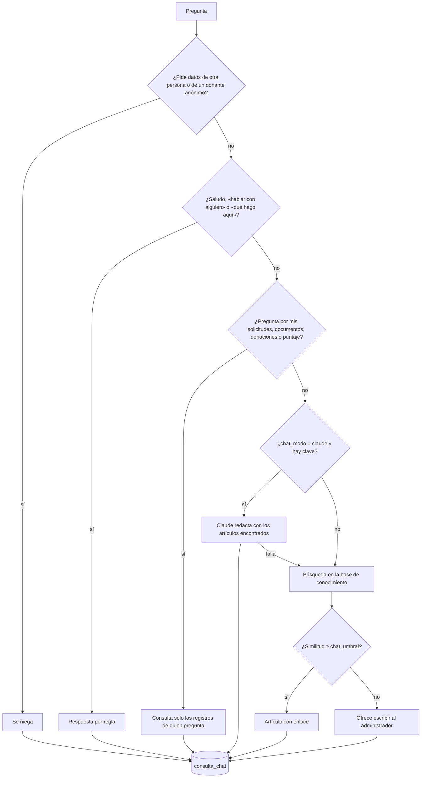
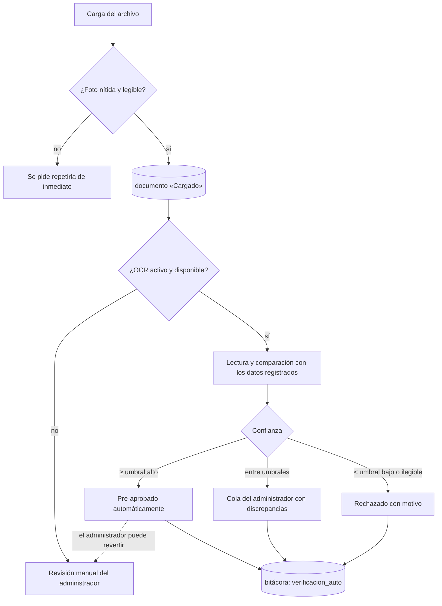
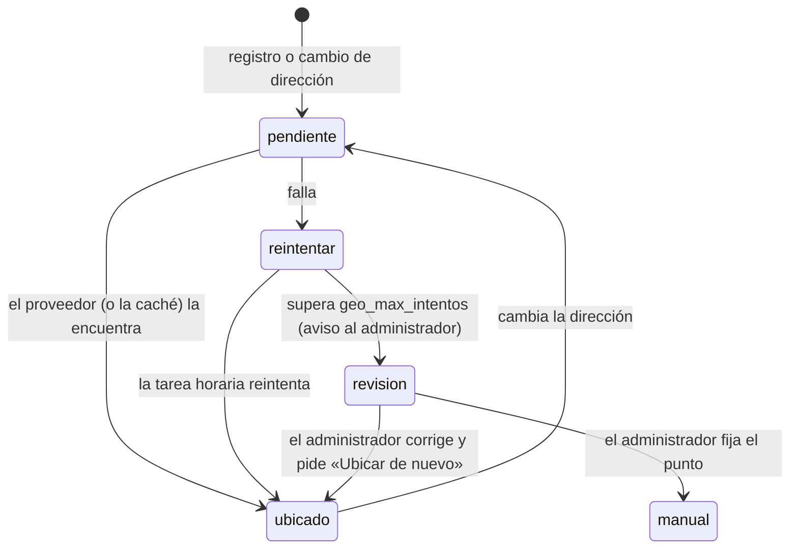
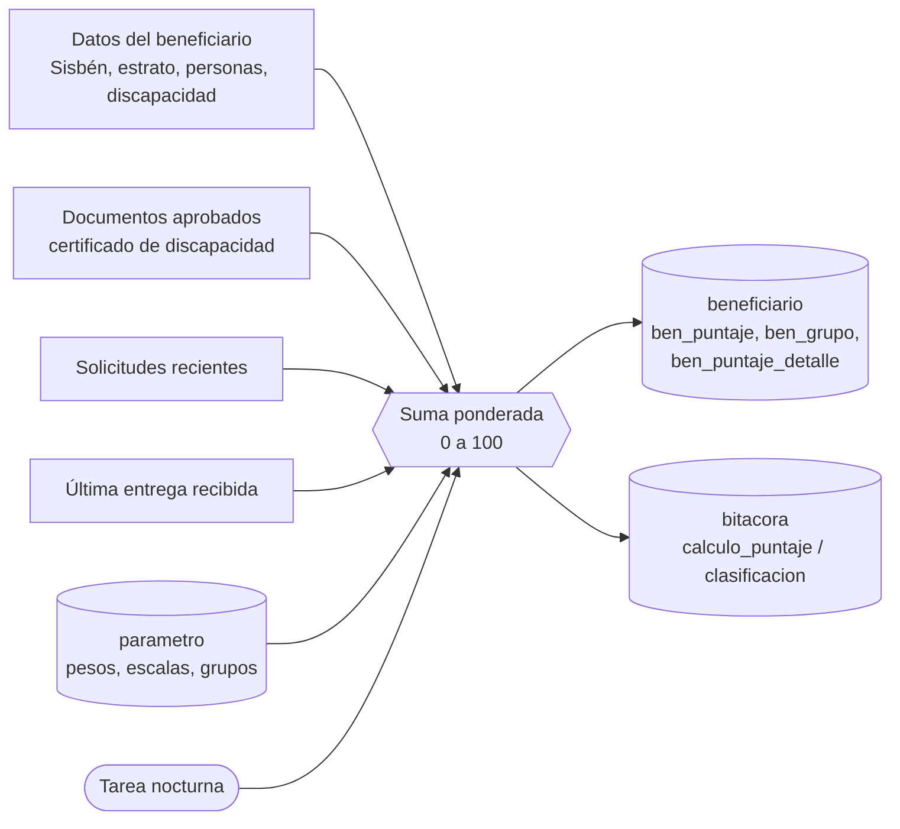
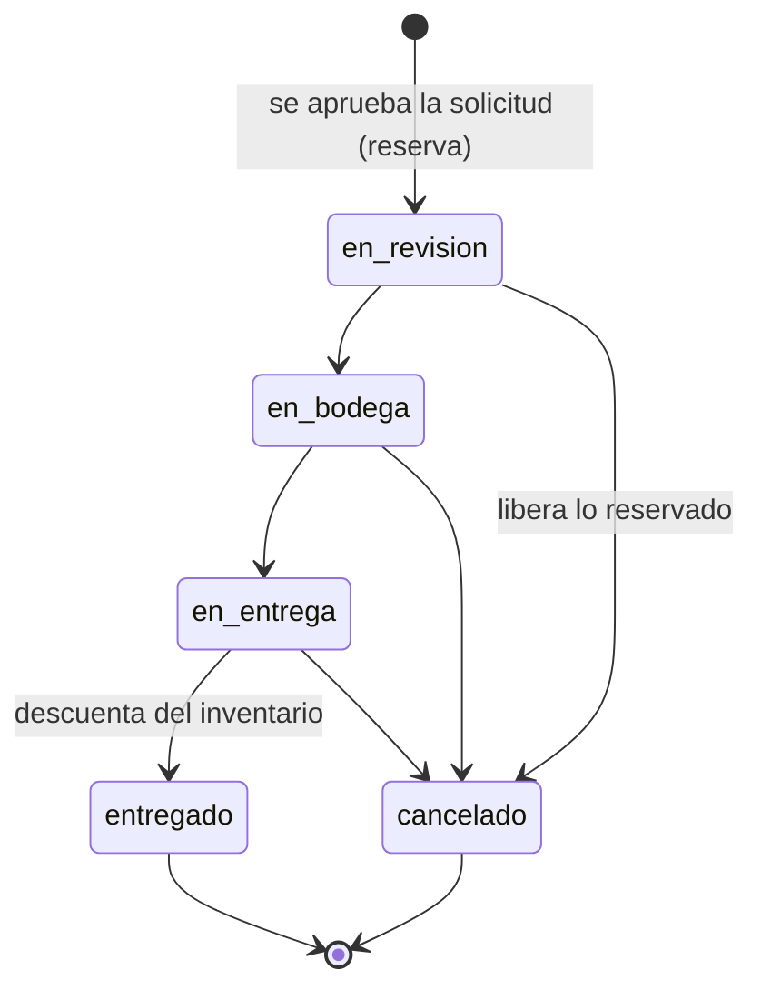
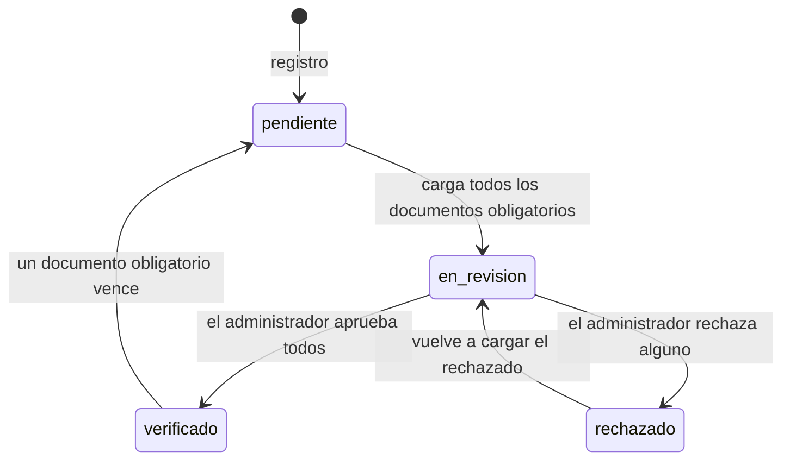
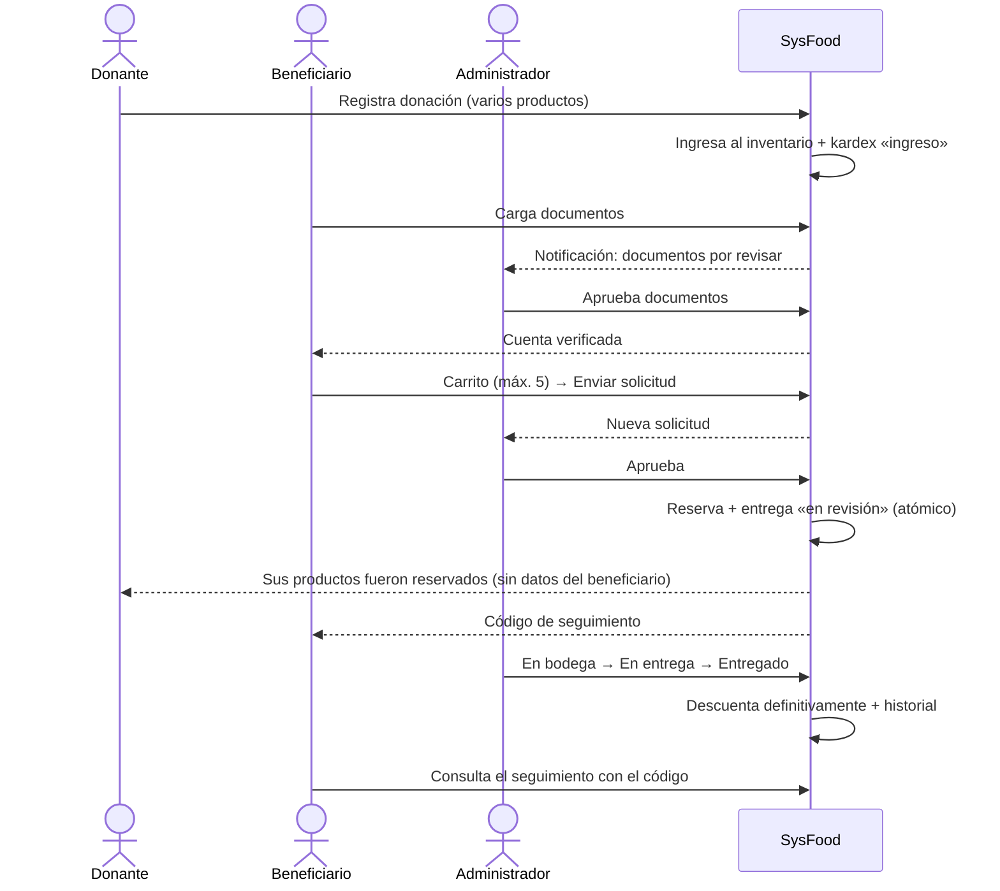

# Modelo de datos

Los nombres de tablas y columnas siguen el documento de requerimientos (por ejemplo `usu_id`, `dona_estado`, `inv_cant_disp`).
GitHub dibuja los diagramas automáticamente.

## Diagrama entidad-relación

```mermaid
erDiagram
    usuario ||--o| donante : "si es donante"
    usuario ||--o| beneficiario : "si es beneficiario"
    usuario ||--o{ documento_validacion : "titular"
    usuario ||--o{ donacion : "dona"
    usuario ||--o{ bodega : "responsable"
    usuario ||--o{ solicitud : "solicita"
    usuario ||--o{ carrito : "arma"
    usuario ||--o{ notificacion : "recibe"
    donacion ||--|{ detalle_donacion : "contiene"
    categoria ||--o{ detalle_donacion : "clasifica"
    detalle_donacion ||--|| inventario : "ingresa como"
    bodega ||--o{ inventario : "almacena"
    categoria ||--o{ inventario : "clasifica"
    inventario ||--o{ kardex : "movimientos"
    inventario ||--o{ carrito : ""
    solicitud ||--|{ solicitud_detalle : "pide"
    inventario ||--o{ solicitud_detalle : ""
    solicitud ||--o| entrega : "genera"
    bodega ||--o{ entrega : "origen"
    entrega ||--|{ entrega_detalle : "lleva"
    inventario ||--o{ entrega_detalle : ""
    usuario ||--o{ consulta_chat : "pregunta (opcional)"
    entrega ||--o{ historial_entrega : "estados"
    entrega ||--o{ kardex : ""
    usuario ||--o{ bitacora : "acciones"
    usuario ||--o{ parametro : "modifica"

    usuario {
        int usu_id PK
        varchar usu_rol "administrador|donante|beneficiario"
        varchar usu_correo UK
        varchar usu_pwd_hash "PBKDF2 con sal"
        varchar usu_nom
        varchar usu_ape
        varchar usu_tel
        varchar usu_estado "activo|inactivo|bloqueado"
        bool usu_acepta_datos
        datetime usu_fec_acepta
        int usu_intentos
        datetime usu_ult_acceso
        datetime usu_bloqueo_hasta
        varchar usu_token_rec "huella SHA-256"
        datetime usu_token_exp
        datetime usu_fec_reg
    }
    donante {
        int usu_id PK,FK
        varchar don_tipo_persona
        varchar don_tipo_doc
        varchar don_doc_nit UK
        varchar don_raz_soc
        varchar don_contacto
        varchar don_dir
        varchar don_frecuencia
        bool don_anonimo_def
    }
    beneficiario {
        int usu_id PK,FK
        varchar ben_tipo_doc "UK con ben_num_doc"
        varchar ben_num_doc
        date ben_fec_exp_doc
        varchar ben_dir
        int ben_num_personas
        varchar ben_sisben
        int ben_estrato "1 a 6"
        bool ben_discapacidad
        varchar ben_estado_verif
        datetime ben_fec_verif
        decimal ben_puntaje "0 a 100, automático"
        varchar ben_grupo "grupo de necesidad"
        json ben_puntaje_detalle "desglose por criterio"
        datetime ben_fec_puntaje
        decimal ben_lat "solo admin"
        decimal ben_lng "solo admin"
        varchar ben_zona
        varchar ben_geo_estado "pendiente|ubicado|reintentar|revision|manual"
        int ben_geo_intentos
        datetime ben_geo_fecha
        varchar ben_geo_detalle
    }
    documento_validacion {
        int docv_id PK
        int usu_id FK
        int usu_id_revisor FK
        varchar docv_tipo
        varchar docv_nom_archivo
        varchar docv_ruta
        varchar docv_mime
        int docv_tam_bytes
        char docv_hash "SHA-256"
        varchar docv_estado
        text docv_obs
        datetime docv_fec_carga
        datetime docv_fec_revision
        date docv_fec_venc
        varchar docv_ocr_estado "pendiente|procesado|no_disponible|error|no_aplica"
        text docv_ocr_texto
        decimal docv_ocr_confianza "0 a 100"
        json docv_ocr_resultado "campos comparados y calidad"
        varchar docv_decision_auto "alta|media|baja|ilegible"
        bool docv_verif_auto
        int docv_ocr_intentos
        datetime docv_fec_ocr
    }
    categoria {
        int cat_id PK
        varchar cat_nom UK
        varchar cat_desc
        bool cat_perecedero
        int cat_dias_alerta
        varchar cat_estado
    }
    bodega {
        int bod_id PK
        int usu_id_resp FK
        varchar bod_nom UK
        varchar bod_dir
        varchar bod_capacidad
        varchar bod_estado
    }
    donacion {
        int dona_id PK
        int usu_id FK
        bool dona_anonima
        varchar dona_estado
        text dona_obs
        datetime dona_fec_reg
        datetime dona_fec_mod
    }
    detalle_donacion {
        int dd_id PK
        int dona_id FK
        int cat_id FK
        varchar dd_nom
        varchar dd_desc
        decimal dd_cantidad "mayor que 0"
        varchar dd_unidad
        date dd_fec_venc
        varchar dd_lote
        varchar dd_estado
    }
    inventario {
        int inv_id PK
        int dd_id FK
        int bod_id FK
        int cat_id FK
        varchar inv_nom
        varchar inv_unidad
        decimal inv_cant_inicial
        decimal inv_cant_disp "CHECK >= 0"
        decimal inv_cant_reserv "CHECK >= 0"
        date inv_fec_venc
        varchar inv_estado
        varchar inv_est_venc
        datetime inv_fec_ingreso
        varchar inv_mot_baja
        datetime inv_fec_baja
        int usu_id_baja FK
    }
    kardex {
        bigint kar_id PK
        int inv_id FK
        int usu_id FK
        int ent_id FK
        varchar kar_tipo
        decimal kar_cantidad
        decimal kar_cant_anterior
        decimal kar_cant_resultante
        varchar kar_motivo
        datetime kar_fecha
    }
    carrito {
        int car_id PK
        int usu_id FK
        int inv_id FK
        decimal car_cant
        datetime car_fec_agregado
    }
    solicitud {
        int sol_id PK
        int usu_id FK
        int usu_id_revisor FK
        varchar sol_estado
        text sol_obs_admin
        datetime sol_fec_envio
        datetime sol_fec_resp
    }
    solicitud_detalle {
        int sd_id PK
        int sol_id FK
        int inv_id FK
        decimal sd_cant
    }
    entrega {
        int ent_id PK
        int sol_id FK
        int bod_id FK
        int usu_id_resp FK
        varchar ent_cod UK
        varchar ent_modalidad
        varchar ent_dir_entrega
        varchar ent_estado
        date ent_fec_prog
        datetime ent_fec_entrega
        varchar ent_mot_cancel
        text ent_obs
        datetime ent_fec_crea
    }
    entrega_detalle {
        int de_id PK
        int ent_id FK
        int inv_id FK
        decimal de_cant_asig
        decimal de_cant_entregada
    }
    historial_entrega {
        bigint his_id PK
        int ent_id FK
        int usu_id FK
        varchar his_estado_ant
        varchar his_estado_nuevo
        varchar his_obs
        datetime his_fecha
    }
    notificacion {
        bigint not_id PK
        int usu_id FK
        varchar not_tipo
        varchar not_titulo
        text not_mensaje
        varchar not_url
        bool not_leida
        datetime not_fecha
    }
    bitacora {
        bigint bit_id PK
        int usu_id FK
        varchar bit_accion
        varchar bit_entidad
        varchar bit_registro
        text bit_detalle
        varchar bit_ip
        datetime bit_fecha
    }
    parametro {
        int par_id PK
        varchar par_clave UK
        varchar par_valor
        varchar par_desc
        int usu_id_mod FK
        datetime par_fec_mod
    }
    geo_cache {
        bigint geo_id PK
        varchar geo_direccion UK "normalizada"
        bool geo_encontrada
        decimal geo_lat
        decimal geo_lng
        varchar geo_zona
        varchar geo_proveedor
        datetime geo_fecha
    }
    tarea_programada {
        varchar tar_nombre PK
        datetime tar_ult_ejecucion
        varchar tar_resultado
        int tar_duracion_ms
    }
    consulta_chat {
        bigint con_id PK
        int usu_id FK "nulo si es visitante"
        varchar con_sesion "huella SHA-256 de la sesión"
        varchar con_canal "web|whatsapp"
        varchar con_rol
        varchar con_pagina
        varchar con_pregunta "números y correos enmascarados"
        text con_respuesta
        varchar con_fuente "regla|busqueda|claude|contexto|privacidad|sin_respuesta|limite"
        varchar con_articulo
        smallint con_similitud "0 a 100"
        bool con_util
        bool con_escalada
        varchar con_contacto
        text con_mensaje
        bool con_atendida
        datetime con_fecha
    }
```

## Respuesta del asistente de ayuda

## Verificación automática de un documento

## Ubicación del beneficiario

## Puntaje y grupo de necesidad

## Estados de la entrega

## Verificación del beneficiario

## Flujo principal

